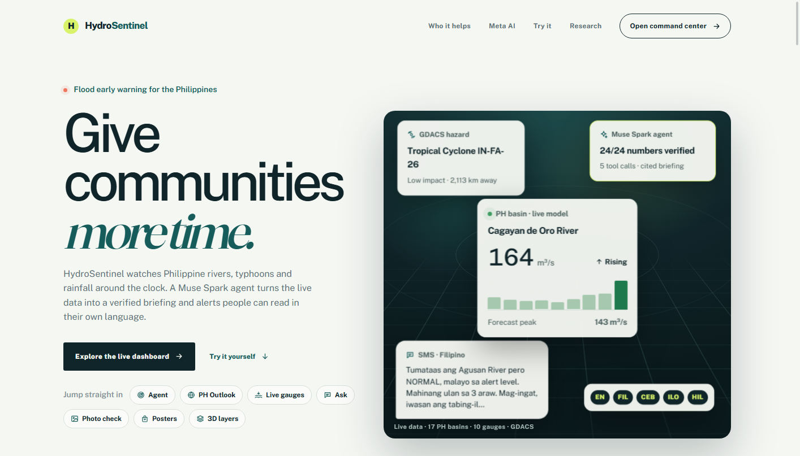
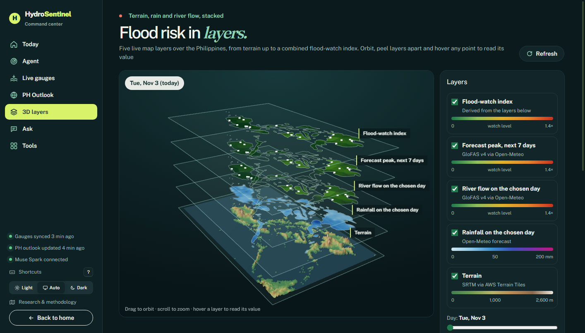
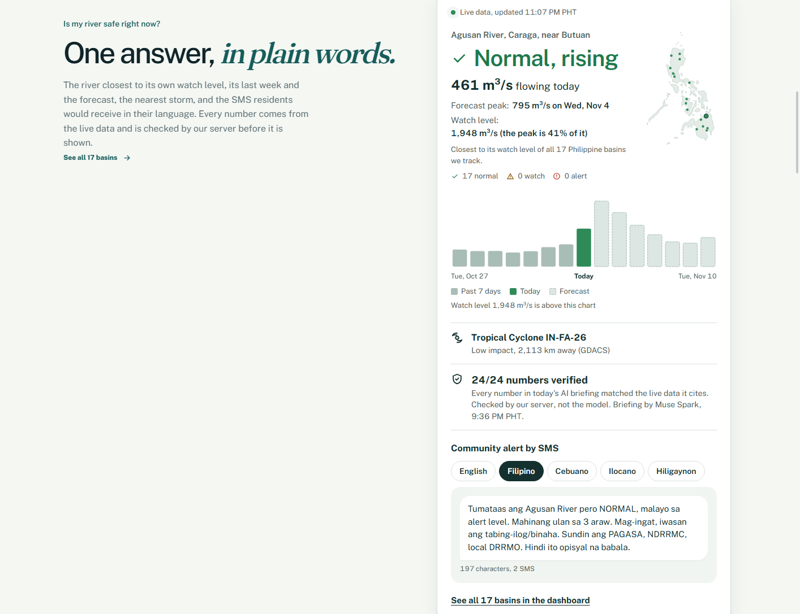
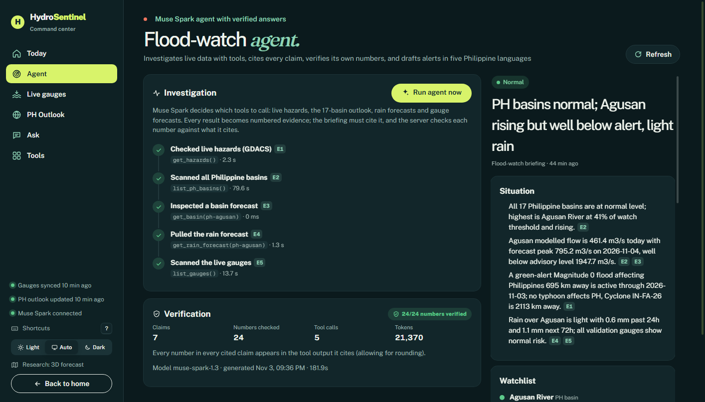
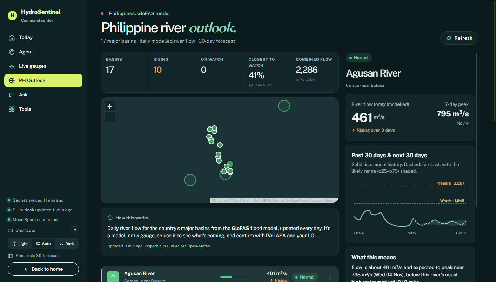
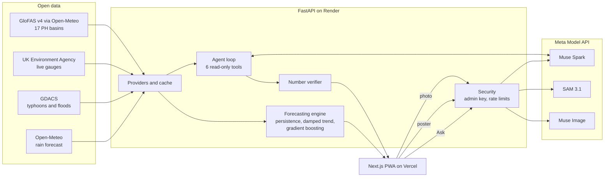

# HydroSentinel

**Flood early warning for the Philippines: a verifiable Muse Spark agent turns live river, rain and typhoon data into cited briefings and SMS alerts in five Philippine languages.**

Live demo: https://hydrosentinel-plum.vercel.app (no login needed)
Problem statement: **Build for Your World**
Built for the Meta Global AI Developer Hackathon 2026. See [HACKATHON.md](HACKATHON.md) for everything built during the event.



## The problem

About 20 tropical cyclones enter the Philippine Area of Responsibility each year ([PAGASA](https://www.pagasa.dost.gov.ph/climate/tropical-cyclone-information)). When a river starts to rise, a barangay disaster officer has little time to decide whether families should move. The data exists, but it is spread across hazard feeds, hydrological models and weather services, in units most people don't read.

## Who it is for

- **Barangay and municipal DRRM offices:** a plain-language briefing on which rivers are rising and how close each one is to its watch level, with an SMS ready to forward.
- **Provincial and LGU planners:** a 30-day flow outlook for 17 major basins, with alert levels based on each river's own five-year record.
- **Families in flood-prone areas:** short, calm messages in Filipino, Cebuano, Ilocano, Hiligaynon or English that always point to PAGASA and local authorities for official warnings.

## What it does

| Feature | What you see |
|---|---|
| Flood-watch agent | Muse Spark investigates live data with six tools, shows each step, and writes a briefing where every claim cites its source |
| Number verification | The server checks every number in the briefing against the tool result it cites and shows the score on every briefing (all numbers verified on the November 3 and 4 runs) |
| SMS alerts | Ready-to-forward text in five languages |
| PH outlook | 17 Philippine basins on a map, with 30-day flow and alert levels |
| Live gauges | Measured river levels every 15 minutes, with backtested forecasts and uncertainty ranges |
| Ask | Questions in English, Filipino or Taglish, answered in the same language from live data, with a status, key points and what to do |
| Photo check | SAM 3.1 measures how much of a field photo is flooded |
| Posters | Muse Image community posters matched to the day's alert level |
| 3D layers | Terrain, rainfall forecast, river flow, forecast peak and a flood-watch index stacked over the Philippines |
| Analytics | Held-out forecast skill against a no-change baseline, interval coverage and model selection for each forecast horizon |
| Research | The forecasting method, parameters and live skill scores |
| Data checker | Validates a CSV of river readings and reports gaps, duplicates and bad values |

### 3D flood layers



### Is my river safe right now?



### Flood-watch agent



### Philippine river outlook



## How it uses Meta AI

All three models are called through the Meta Model API, from the server only.

| Model | Where | What it does |
|---|---|---|
| Muse Spark `muse-spark-1.3`, tool calling | `backend/app/ai/agent.py` | The agent picks from six read-only tools (GDACS hazards, all basins, one basin, rain forecast, all gauges, one gauge) for up to 8 steps and keeps an evidence log |
| Muse Spark `muse-spark-1.3`, structured output | `backend/app/ai/agent.py`, `backend/app/ai/analyst.py` | Schema-constrained briefing with cited claims and SMS in five languages; Ask answers |
| SAM 3.1 `sam-3.1` | `backend/app/ai/segmentation.py` | Segments water in a photo and returns the flooded share with a mask overlay |
| Muse Image `muse-image-1.0` | `backend/app/api/ai.py` | Preparedness and alert posters |

The shared client is `backend/app/ai/meta_client.py`.

## Architecture



1. Providers fetch and cache open data. Each reading keeps its source.
2. The forecasting engine scores three models on held-out data for each horizon and attaches calibrated uncertainty ranges.
3. The agent asks Muse Spark which tool to call next, runs it, and logs the result as evidence.
4. Muse Spark writes the briefing as JSON that must cite evidence IDs.
5. The verifier checks every number against the cited evidence before the briefing is shown.

## Run it locally

You need Python 3.12 with [uv](https://docs.astral.sh/uv/), and Node.js 20 or later.

```bash
git clone https://github.com/Debb1ie/Meta-AI.git
cd Meta-AI
cp .env.example .env    # then add your own META_MODEL_API_KEY and ADMIN_TOKEN
```

Backend:

```bash
cd backend
uv sync
uv run uvicorn app.main:app --reload --port 8000
```

Frontend, in a second terminal:

```bash
cd frontend
npm install
echo "NEXT_PUBLIC_API_URL=http://localhost:8000" > .env.local
npm run dev
```

Open http://localhost:3000.

Without a Meta Model API key, every data feature still works. The AI features show a clear "not configured" message instead of failing.

Tests:

```bash
cd backend
uv run pytest -q
```

### Environment variables

The names are listed in [.env.example](.env.example). Never commit real values.

| Variable | Purpose |
|---|---|
| `META_MODEL_API_KEY` | Meta Model API key (server only) |
| `ADMIN_TOKEN` | Key for data-changing routes. If it isn't set, those routes are switched off. |
| `META_TEXT_MODEL`, `META_SEGMENTATION_MODEL`, `META_IMAGE_MODEL` | Model IDs |
| `CORS_ORIGINS` | Allowed frontend origins |
| `LIVE_DATA_ENABLED`, `LIVE_REFRESH_MINUTES` | Live data sync |
| `AGENT_AUTORUN_HOURS`, `AGENT_COOLDOWN_MINUTES`, `AGENT_MAX_RUNS_PER_DAY` | Agent schedule and credit protection |

### Deploy

- **API:** Render, using the blueprint in [render.yaml](render.yaml).
- **Frontend:** Vercel, with root directory `frontend` and `NEXT_PUBLIC_API_URL` pointing to the API.

## Trust and safety

- The server, not the model, checks every number in a briefing.
- Muse Spark follows a shared plain-language style guide (`backend/app/ai/style.py`): answer first, everyday words, no internal jargon, and alerts that read like a neighbour's text.
- Every briefing and SMS says it is model guidance and points to PAGASA, NDRRMC and local DRRM offices for official warnings.
- Model keys stay on the server. Data-changing routes need an admin key. Every AI route is rate-limited and capped at 8,000 output tokens.
- Feed and tool data are treated as untrusted in prompts.
- Photos are processed in memory and never stored. There are no accounts. See the privacy page at `/privacy`.

Reports:

- [Security](reports/security.md)
- [Readiness](reports/readiness.md)
- [Fact-check](reports/fact-check.md)
- [Anomaly sweep](reports/anomalies.md)

Product documents are in [docs/product](docs/product).

## Known limitations

- **Philippine river flow is modelled, not measured.** Real-time Philippine gauge data isn't openly available. GloFAS gives modelled daily discharge, and measured UK gauges are used to test the forecasting engine against reality.
- **Alert levels are statistical, not official.** They are the 95th, 99th and 99.8th percentiles of each river's last five years, not PAGASA warning levels.
- **Free hosting sleeps.** The first request after a long idle period can take up to a minute, even with the keep-awake ping.
- **Free hosting resets data on restart.** After a deploy or restart, the gauges re-sync and forecasts retrain, so Analytics and gauge views fill in after a few minutes.
- **Forecast skill fades with lead time.** On held-out data the gauge forecasts beat the no-change baseline at 1 to 12 hours ahead, but not at 24 hours. The Analytics tab shows the live numbers.
- **Date format in the data checker.** Use ISO dates such as `2026-11-03 10:00`. Day-first dates such as `03/11/2026` are read month-first.
- **Language review.** SMS text in Ilocano and Hiligaynon hasn't been reviewed by native speakers yet.

## Data and licences

| Source | Licence |
|---|---|
| GloFAS v4 river discharge via the Open-Meteo Flood API | CC BY 4.0 |
| Open-Meteo weather and rain | CC BY 4.0 |
| UK Environment Agency real-time flood monitoring | Open Government Licence v3 |
| GDACS alerts | Free use with attribution |
| Natural Earth country outline (via world-atlas) | Public domain (world-atlas: ISC) |
| Fonts: Fraunces, Public Sans, Geist Mono | SIL Open Font License |

The demo CSV in `frontend/public/samples/` is synthetic and was made for this project.

## Team

Precious Grace Deborah Manucom ([Debb1ie](https://github.com/Debb1ie))
