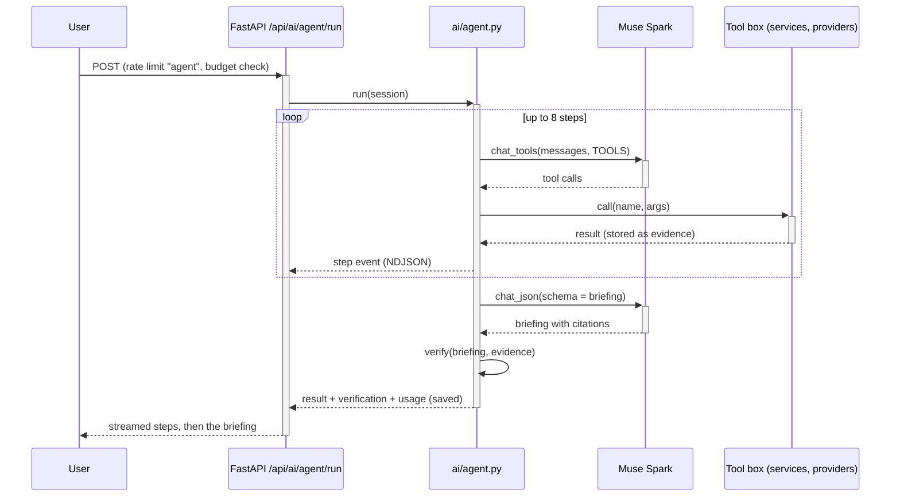

# RFC-0001: Verifiable flood-watch agent

**Author:** Debb1ie | **Status:** Implemented | **Target Version:** v1.0.0

---

## Document Information

| Attribute | Value |
|-----------|-------|
| Document Type | Request for Comments (RFC) |
| Version | 1.0.0 |
| Last Updated | 2026-11-03 |
| Execution State | Completed |
| GitHub Issue | None; work tracked in the repository history |

---

## Document Changelog

| Version | Date | Changed By | Summary of Changes |
|---------|------|------------|-------------------|
| 1.0.0 | 2026-11-03 | Debb1ie | RFC written to record the implemented design |

---

## Summary

DRRM offices need a short briefing on which rivers and storms matter now, and they need to trust every number in it. This RFC describes a Muse Spark agent that investigates live data through six tools, writes a structured briefing in which every claim cites a tool result, and is checked by deterministic server code that compares each number with its cited source. The result is a briefing that shows "N of N numbers verified" and flags any number that does not match. It runs automatically every 3 hours within a fixed budget.

---

## Background

HydroSentinel already had a Q&A analyst (`ai/analyst.py`) that answered from a compact data context. It could not decide what to look at, and its numbers were not checked. Muse Spark supports native tool calling and JSON-schema output through the Meta Model API.

### Problem Statement
A model-written flood briefing can contain numbers that are not in the data. Users cannot tell which numbers are real.

### Goals
- Let the model choose what to investigate across hazards, basins, rain and gauges.
- Require a citation for every situation line and watchlist entry.
- Check every number in code and show the result on the briefing.
- Bound steps, tokens and runs per day.
- Show the investigation step by step as it happens.

### Non-Goals
- Checking wording, tone or reasoning (only numbers and citations are checked).
- Sending alerts; the agent drafts an SMS but does not deliver it.
- Replacing official warnings.

### Related Documents

| Document | Type | Relationship |
|----------|------|--------------|
| [PRD-0001](../product/PRD-0001-hydrosentinel.md) | PRD | Feature 1.3 |
| [ADR-0003](../architecture/ADRs/ADR-0003-verifiable-agent-with-numeric-checks.md) | ADR | The decision this RFC implements |
| [ADR-0004](../architecture/ADRs/ADR-0004-admin-key-and-rate-limits.md) | ADR | Rate limits and budget |
| [AD-0001](../architecture/AD-0001-system-architecture.md) | AD | Where the agent sits |
| [TP-0001](TP-0001-test-plan.md) | TP | Tests |

---

## Proposal

### Overview
`backend/app/ai/agent.py` runs a tool-calling loop with Muse Spark (`muse-spark-1.3`) for at most 8 steps, then asks for a final JSON briefing that matches a schema. `verify()` checks the briefing against the stored tool results. The run streams progress as NDJSON and saves the final result, which `GET /api/ai/agent/latest` serves.

### Detailed Design

#### Tools

Each tool reads from the same services as the dashboard, so the agent sees exactly what users see.

**Domain Model:**

| Entity | Field | Type | Required | Description |
|--------|-------|------|----------|-------------|
| Tool call | id | string | yes | Id used as a citation, for example the call id returned by the model |
| Tool call | name | string | yes | One of the six tools |
| Tool call | args | object | yes | Arguments, for example `basin_id` |
| Tool call | result | object | yes | The JSON returned to the model, stored as evidence |
| Briefing | situation | list of {text, evidence[]} | yes | Short situation lines, each citing tool-call ids |
| Briefing | watchlist | list of {name, kind, level, reason, evidence[]} | yes | Places to watch, each citing evidence |
| Briefing | sms | object | yes | SMS draft in the chosen language |
| Verification | numbers_checked | int | yes | Numbers found in claims |
| Verification | numbers_verified | int | yes | Numbers matched in cited evidence |
| Verification | unverified | list of {claim, number} | yes | Numbers that did not match |
| Verification | bad_refs | list of string | yes | Citations that point to no tool call |
| Verification | score | float | yes | verified / checked, 1.0 when nothing to check |

**Key Interfaces:**

| Interface | Methods | Purpose |
|-----------|---------|---------|
| `get_hazards` | `()` | Active cyclones and floods from GDACS, nearest the Philippines first, plus UK flood warnings |
| `list_ph_basins` | `()` | All 17 basins: flow today, 3-day trend, 7-day peak, peak as % of Watch, level |
| `get_basin` | `(basin_id)` | One basin: levels in m³/s, last 7 and next 14 days with likely range |
| `get_rain_forecast` | `(place_id)` | Rain totals for the next 6, 24 and 72 hours and per day |
| `list_gauges` | `()` | Live gauges: level, rate of rise, 24 h forecast, risk, data age |
| `get_gauge` | `(gauge_id)` | One gauge: levels, forecasts with 80% range, skill vs persistence, risk explanation |
| `meta_client.chat_tools` | `(messages, tools, temperature=0.2) -> (message, usage)` | One tool-calling turn |
| `meta_client.chat_json` | `(messages, schema, schema_name, temperature=0.2) -> (dict, usage)` | Final structured briefing |
| `agent.verify` | `(briefing, evidence) -> dict` | Numeric verification |

**Interaction Flow (optional):**

#### Verification

1. Collect claims: each situation line and each watchlist entry as "name: reason", with their citations.
2. Citations that do not match a stored tool call are added to `bad_refs`.
3. Build a pool of numbers from the cited results: every numeric value, numbers inside strings, and the length of every list (so "all 17 basins" is supported).
4. Remove ISO dates, month-day mentions ("Nov 4", "Oct 29-Nov 3") and times of day from the claim, then extract its numbers.
5. A number is verified if it is within `max(0.051, 2% of the source value)` of any pool number. This accepts normal rounding (463.5 written as 464 or 460).
6. Report counts, unverified numbers with their claim, bad references and a score.

#### Budget and scheduling

- `budget_reason(cooldown_minutes, max_runs_per_day)` returns a message instead of running when the last briefing is younger than 10 minutes or 40 runs have happened today.
- A second run while one is in progress returns 409.
- `main._maybe_run_agent` starts a run when the latest briefing is older than `agent_autorun_hours` (3).

### API Changes

#### New Endpoints

| Endpoint | Method | Description | Request | Response |
|----------|--------|-------------|---------|----------|
| `/api/ai/agent/run` | POST | Start a run and stream its progress | Empty body | `application/x-ndjson`: step events, then the result with `verification` and usage |
| `/api/ai/agent/latest` | GET | The most recent saved briefing | None | Briefing, steps, verification, usage, time; or null |

#### Modified Endpoints

| Endpoint | Change | Backward Compatible |
|----------|--------|---------------------|
| `/api/ai/status` | Reports whether the Meta Model API is configured | Yes |
| `/api/research` | Exposes `max_steps`, tool names, languages and the number tolerance | Yes |

### Data Model Changes

#### New Tables/Collections

No new tables. The latest result is saved by `_save()` in `ai/agent.py` and read by `latest()`. It is replaced on each run, so no migration is needed.

#### Modified Tables

| Table | Change | Migration Strategy |
|-------|--------|-------------------|
| None | No table changes | Not applicable |

### Configuration Changes

| Config | Type | Default | Description |
|--------|------|---------|-------------|
| `META_MODEL_API_KEY` | secret string | empty | Meta Model API key; AI routes return 503 when empty |
| `meta_text_model` | string | `muse-spark-1.3` | Model used by the agent and analyst |
| `meta_max_output_tokens` | int | 8000 | Output token cap per call |
| `agent_autorun_hours` | float | 3 | Age at which a scheduled run starts |
| `agent_cooldown_minutes` | float | 10 | Minimum gap between runs |
| `agent_max_runs_per_day` | int | 40 | Daily cap on runs |

---

## Implementation Plan

### Phase Outline

| Phase | Description | Key Deliverables |
|-------|-------------|------------------|
| 1 | Tools over existing services | Six tools in `ai/agent.py` |
| 2 | Tool-calling loop and final schema | `chat_tools`, `chat_json`, briefing schema |
| 3 | Verification | `verify()`, `_numbers_in()`, `_supported()` |
| 4 | Streaming and storage | NDJSON route, `latest`, `_save` |
| 5 | Budget and schedule | `budget_reason`, `_maybe_run_agent`, rate limit |
| 6 | Frontend | `featured/agent.tsx` with steps, citations and verification |

### Migration Strategy
Not applicable; this is a new feature with no stored data to migrate.

---

## Testing Strategy

### Unit Tests

| Component | Test Coverage | Priority |
|-----------|---------------|----------|
| `agent.verify` and `budget_reason` | `backend/tests/test_agent.py` (4 tests); line coverage not measured | High |
| `meta_client.chat_json` parsing and HTTP errors | `backend/tests/test_ai.py` (part of its 10 tests) | High |

**Key Test Cases:**
- `test_verify_accepts_rounded_numbers_counts_and_dates`: rounded values, list counts and dates pass.
- `test_verify_flags_invented_numbers_and_unknown_evidence`: invented numbers are unverified and unknown citations go to `bad_refs`.
- `test_verify_ignores_negative_signs_and_iso_timestamps`: signs and ISO timestamps do not cause false flags.
- `test_budget_guard_serves_fresh_briefing_and_caps_runs`: cooldown and daily cap.

### Integration Tests

| Integration | Test Approach | Priority |
|-------------|---------------|----------|
| AI routes with no API key | `test_api.py::test_ai_endpoints_fail_clearly_without_key` expects a clear error | High |
| Full agent loop with a scripted Meta client | Not automated yet; checked by running the agent in production | Medium |

### E2E Tests

| Scenario | Steps | Expected Result |
|----------|-------|-----------------|
| Watch a run | Open `/featured?tab=agent`, start a run | Steps appear one by one; briefing shows verification count |
| Open a citation | Tap a citation chip | The cited tool result is shown |
| Cooldown | Start two runs within 10 minutes | Second returns the fresh briefing message |

### Performance Tests

| Test | Target | Measurement |
|------|--------|-------------|
| Tokens per run | About 20,000 | `usage` saved with the briefing |
| Steps per run | At most 8 | Count of step events |

---

## Acceptance Criteria

- [x] The agent calls tools and produces a briefing with citations on every claim
- [x] Unmatched numbers and bad citations are reported, not hidden
- [x] Runs stop at 8 steps and respect the cooldown, daily cap and rate limit
- [x] All unit tests pass (line coverage is not measured in this project)
- [x] All integration tests pass
- [x] API documentation updated (FastAPI OpenAPI at `/docs`)
- [x] The last production run verified 24 of 24 numbers

### Criterion Details

| Criterion | Test Method | Expected Result |
|-----------|-------------|-----------------|
| Verification correctness | `test_agent.py` | Verified, unverified and bad-ref cases classified correctly |
| Budget | Two manual runs within 10 minutes | Second returns the "still fresh" message |
| Production quality | Check `/api/ai/agent/latest` | `numbers_verified` equals `numbers_checked` |

---

## Security Considerations

| Consideration | Mitigation | Status |
|---------------|------------|--------|
| Model key exposure | Key only in Render environment; never sent to the browser | Addressed |
| Cost abuse | `agent` rate limit (2/min, 20/day per client, 120/day global) plus cooldown and daily cap | Addressed |
| Prompt injection via data | Tools return structured JSON from trusted providers; numbers are checked in code | Addressed |
| Over-trust | Every briefing points to PAGASA and local authorities | Addressed |

### Security Checklist
- [x] Input validation implemented (tool arguments are checked against known ids)
- [x] Authentication/authorization verified (public read; limits on runs)
- [x] Sensitive data encrypted (no personal data; TLS in transit)
- [ ] Audit logging added (not added; runs appear only in access logs)
- [x] No secret values in prompts, logs or responses

---

## Performance Considerations

| Consideration | Impact | Mitigation |
|---------------|--------|------------|
| Model latency per step | A run takes several model calls | Stream steps so users see progress |
| Large tool results | More tokens | Results are compact and rounded (`_round`) |
| Free instance CPU | Tools read cached forecasts | Forecasts warmed by the background loop |

### Benchmarks

| Operation | Current | Expected | Acceptable |
|-----------|---------|----------|------------|
| Tool calls per run | 5 | 4 to 6 | 8 |
| Tokens per run | About 20,000 | About 20,000 | 40,000 |
| Cost per run | About US$0.04 | About US$0.04 | US$0.10 |

---

## Monitoring & Observability

### Metrics

| Metric | Type | Labels | Alert Threshold |
|--------|------|--------|-----------------|
| `numbers_verified / numbers_checked` | gauge (per briefing) | run time | Below 1.0 is shown on the briefing |
| Tokens per run | gauge (per briefing) | model | Above 40,000 reviewed by hand |
| Runs today | counter | none | 40 (hard cap) |

### Logging

| Event | Level | Fields |
|-------|-------|--------|
| "Agent briefing ready: N tool calls, verification N%" | INFO | tool calls, verification score |
| "Agent autorun failed: ..." | WARNING | error text (no secrets) |
| "Agent autorun crashed" | ERROR | exception trace |

### Alerts

| Alert | Condition | Severity | Runbook |
|-------|-----------|----------|---------|
| No fresh briefing | Latest briefing older than 6 h | Warning | Check `/api/ai/status` and Render logs |
| Unverified numbers | Score below 1.0 | Info | Read the flagged claims on the agent tab |

---

## Rollout Plan

### Rollout Stages

| Stage | % Traffic | Duration | Success Criteria |
|-------|-----------|----------|------------------|
| Local | 0% | Development | Tests pass with a mocked client |
| Production | 100% | From 2026-11-03 | Briefings verify fully; no budget overruns |

Canary stages were not used: the app runs as a single instance with no traffic splitting.

### Rollback Plan

**Trigger Conditions:**
- Repeated failed runs or unverified numbers in most briefings
- Unexpected model cost

**Rollback Steps:**
1. Set `agent_max_runs_per_day` to 0 to stop new runs; the last briefing stays visible.
2. Redeploy the previous Render deployment if the code is at fault.

**Rollback Time:** About 5 minutes (environment change and Render restart)

---

## Abandoned Ideas

### Model-as-judge verification

**Description:** A second model call grades the briefing.

**Reason Abandoned:** Not deterministic and doubles cost; see ADR-0003.

### Dropping unverified claims

**Description:** Remove claims that fail the check before display.

**Reason Abandoned:** Hides problems from users; flagging is more honest.

---

## Open Questions

- [ ] Should derived numbers (differences, percentages computed by the model) be supported by recomputing them? - Owner: Debb1ie
- [ ] Should briefings be kept as a history rather than only the latest? - Owner: Debb1ie

---

## References

- `backend/app/ai/agent.py`, `backend/app/ai/meta_client.py`, `backend/app/api/ai.py`
- `frontend/src/app/featured/agent.tsx`

---

## Approval Checklist

- [x] Technical design reviewed
- [x] Security review completed
- [x] Performance impact assessed
- [x] Test plan approved
- [x] Documentation plan approved
- [x] Rollback plan validated
- [x] Monitoring plan approved

---

## Approvals

| Role | Name | Date | Status | Notes |
|------|------|------|--------|-------|
| Tech Lead | Debb1ie | 2026-11-03 | Approved | |
| Architect | Debb1ie | 2026-11-03 | Approved | |
| Product | Debb1ie | 2026-11-03 | Approved | |

---

**RFC Owner:** Debb1ie
**Target Completion:** 2026-11-03
